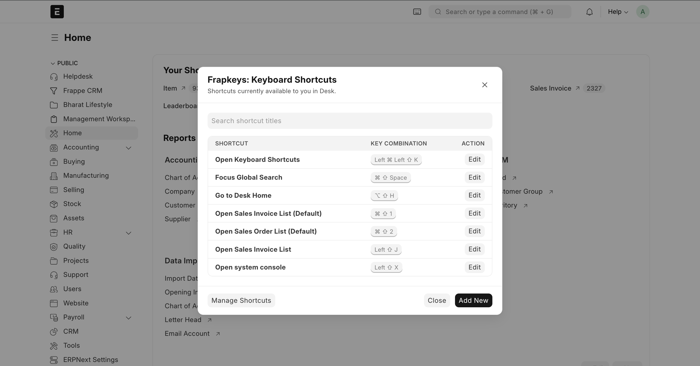
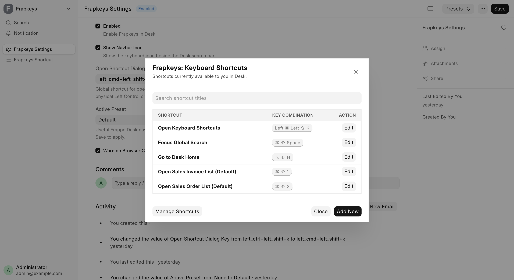
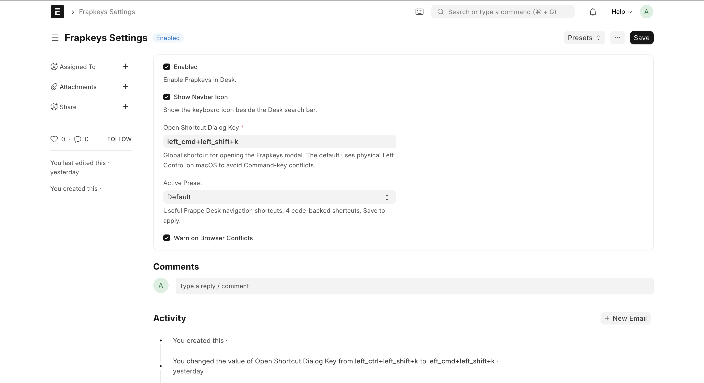
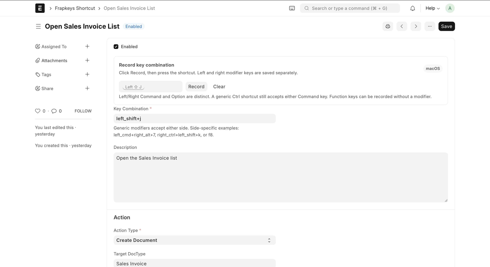
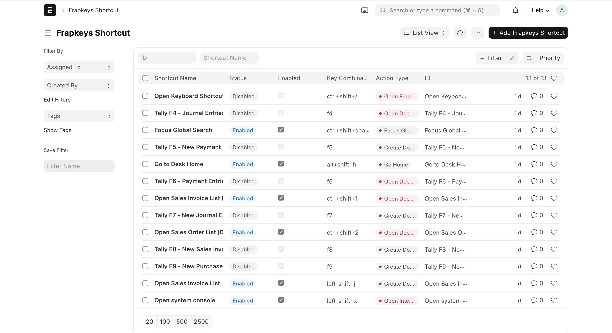

# Frapkeys

**Your Desk. Your keys. Your flow.**

## Installation

Run these commands from your Frappe Bench directory:

```bash
bench get-app https://github.com/devlpr-nitish/frapkeys.git
bench --site your-site.local install-app frapkeys
bench build --app frapkeys
bench --site your-site.local migrate
```

Log in to Desk, open **Frapkeys Settings**, choose a preset, and start navigating faster.

## Compatibility

Frapkeys supports both **Frappe Framework v15** and **Frappe Framework v16**. It detects the
active Frappe major version in Desk and adapts the navbar launcher and keyboard-shortcut modal
to the corresponding interface.

| Frappe version | Support |
| --- | --- |
| Version 15 | Supported |
| Version 16 | Supported |

ERPNext is optional. When used, install the ERPNext branch matching the Frappe major version.

## Description

Frapkeys brings fast, configurable keyboard shortcuts to Frappe and ERPNext Desk.

- Open DocType lists, new documents, reports, Desk routes, and external links.
- Use left/right-specific modifier keys across macOS, Windows, and Linux.
- Choose built-in **Default** or **Tally** presets and restore deleted preset shortcuts.
- Search and manage shortcuts from a compact navbar modal.
- Avoid overlapping shortcuts with server-side conflict validation.

## Screenshots

### Keyboard shortcut modal — Frappe v15



### Keyboard shortcut modal — Frappe v16



### Settings



### Create or edit a shortcut



### Manage shortcuts



## Contributing

1. Fork the repository and create a feature branch.
2. Install the development checks:

   ```bash
   cd apps/frapkeys
   pre-commit install
   ```

3. Make your changes and verify them:

   ```bash
   pre-commit run --all-files
   bench build --app frapkeys
   ```

4. Open a pull request with a clear description and testing notes.

## Creator

Built by **Nitish** — [www.devlprnitish.tech](https://www.devlprnitish.tech)

Licensed under the MIT License.
